# Gerenciador de Tarefas — P2 Programação Mobile

Aplicativo Flutter de gerenciamento de tarefas pessoais com **Firebase Authentication** (e-mail/senha), **Firebase Realtime Database**, **SharedPreferences** e temas claro/escuro.

## Funcionalidades

- Cadastro (nome, e-mail, senha), login e logout; a sessão é mantida pelo Firebase ao reabrir o app.
- Tela inicial com o nome do usuário e contagem de tarefas cadastradas, pendentes e concluídas.
- Menu lateral (Drawer) com Início, Minhas tarefas, Configurações, Sobre o aplicativo e Sair, mostrando nome e e-mail.
- CRUD de tarefas (título, descrição, vencimento, prioridade Baixa/Média/Alta, situação Pendente/Concluída).
- Listagem em `ListView` com cor da prioridade (verde/laranja/vermelho), checkbox para concluir/reabrir e detalhes ao tocar.
- Atualização em tempo real via listener `onValue` do Realtime Database.
- Tarefas salvas em `tarefas/{uid}` — cada usuário só lê/escreve as suas (ver `database.rules.json`).
- Tema claro/escuro salvo com SharedPreferences e aplicado em todas as telas.

## Estrutura

```
lib/
├── main.dart                  # inicialização, MaterialApp com temas e AuthGate
├── firebase_options.dart      # gerado pelo flutterfire configure
├── models/        usuario.dart, tarefa.dart
├── screens/       login, cadastro_usuario, home, tarefas, cadastro_tarefa, configuracoes
├── services/      auth_service, firebase_service (CRUD), preferences_service
├── widgets/       drawer_menu.dart
└── themes/        app_theme.dart (lightTheme, darkTheme, ThemeController)
```

## Requisitos

- Flutter 3.50 ou mais novo (Gradle 9.5, Android Gradle Plugin 9.3, Java 17)
- Android SDK com NDK 30 (`android/app/build.gradle.kts` → `ndkVersion`)

## Firebase

O repositório já vem configurado com o projeto `gerenciador-de-tarefas-a1b50`:

- `lib/firebase_options.dart` e `android/app/google-services.json`, gerados pelo `flutterfire configure`;
- `firebase.json`, que ativa o login por **e-mail/senha** e publica as regras de `database.rules.json` no Realtime Database.

O pacote Android é `com.p2.gerenciadortarefas` (sem `_`, porque o Firebase recusa registrar nomes de pacote com underscore).

Para usar **outro** projeto Firebase:

```bash
npm install -g firebase-tools
dart pub global activate flutterfire_cli
firebase login
flutterfire configure            # escolha o projeto e as plataformas android/web
firebase deploy --only auth,database --project SEU_PROJETO
```

Confira se o `firebase_options.dart` gerado contém `databaseURL`; se não tiver, adicione a URL do seu Realtime Database.

## Como executar

```bash
flutter pub get
flutter run
```

## Estrutura dos dados no Realtime Database

```
usuarios/
  {uid}: { nome, email }
tarefas/
  {uid}/
    {idTarefa}: { titulo, descricao, dataVencimento, prioridade, concluida }
```

## Capturas de tela

| Login | Cadastro de usuário | Tela inicial | Menu (Drawer) |
|---|---|---|---|
| 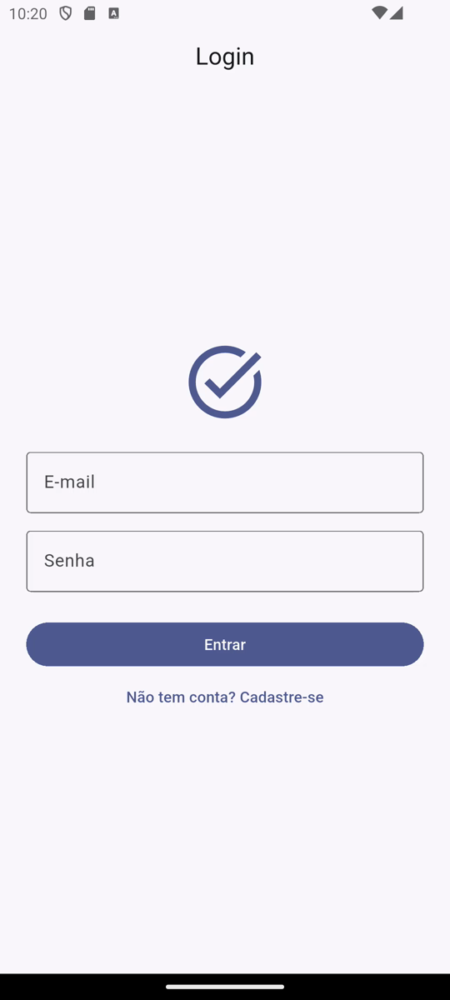 | 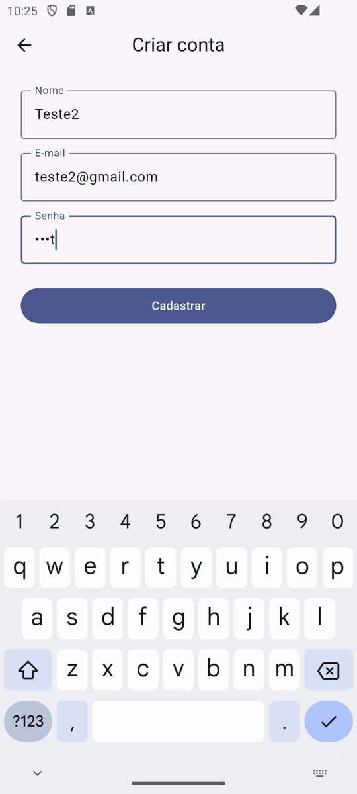 | 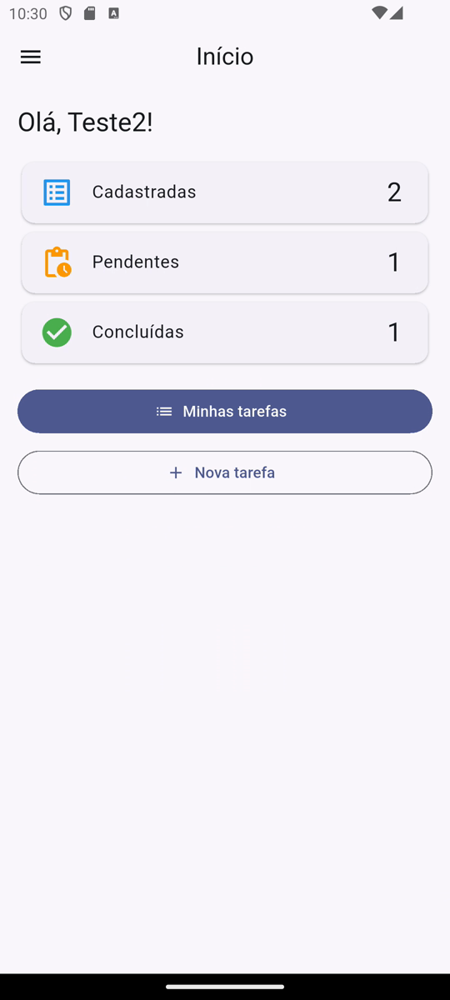 | 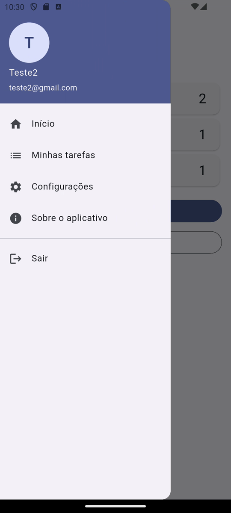 |

| Nova tarefa | Lista (ListView) | Detalhes | Edição |
|---|---|---|---|
| 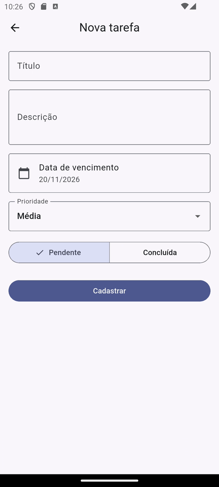 | 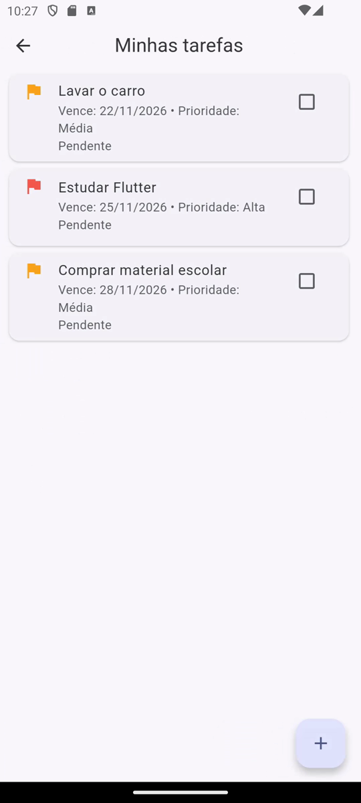 | 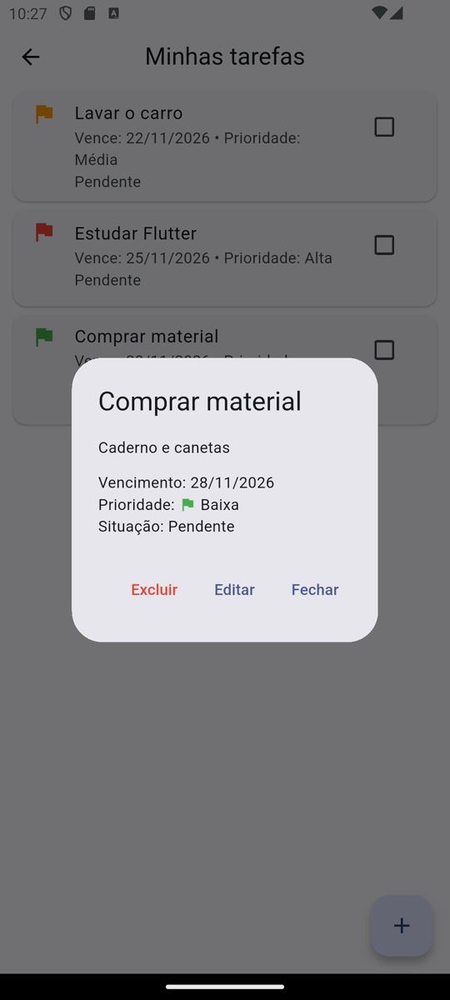 | 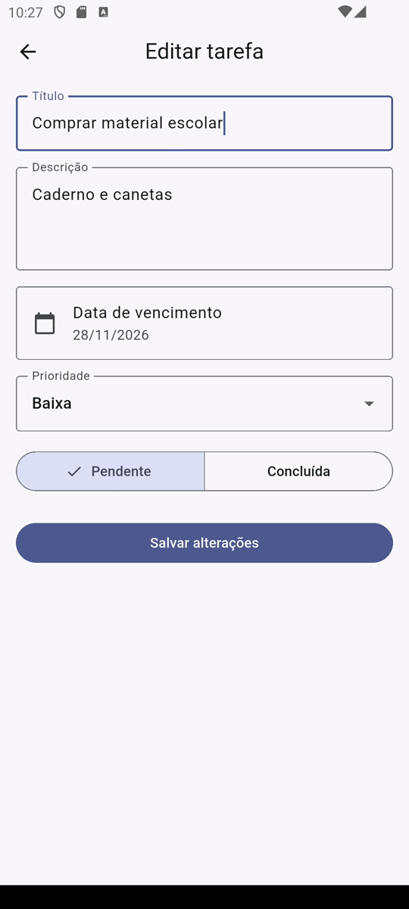 |

| Exclusão | Tarefa concluída | Tema escuro | Início no tema escuro |
|---|---|---|---|
| 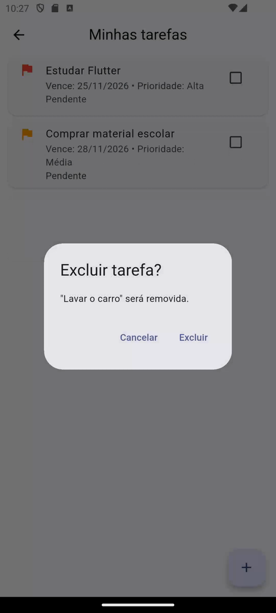 | 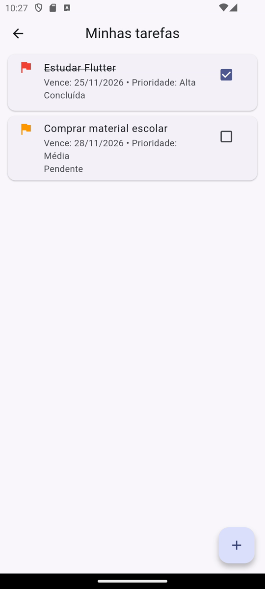 | 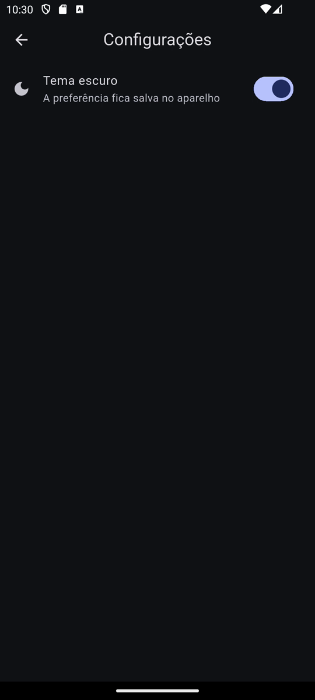 | 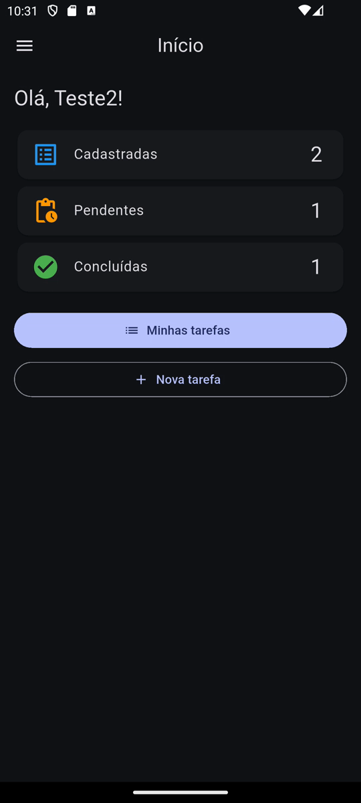 |
